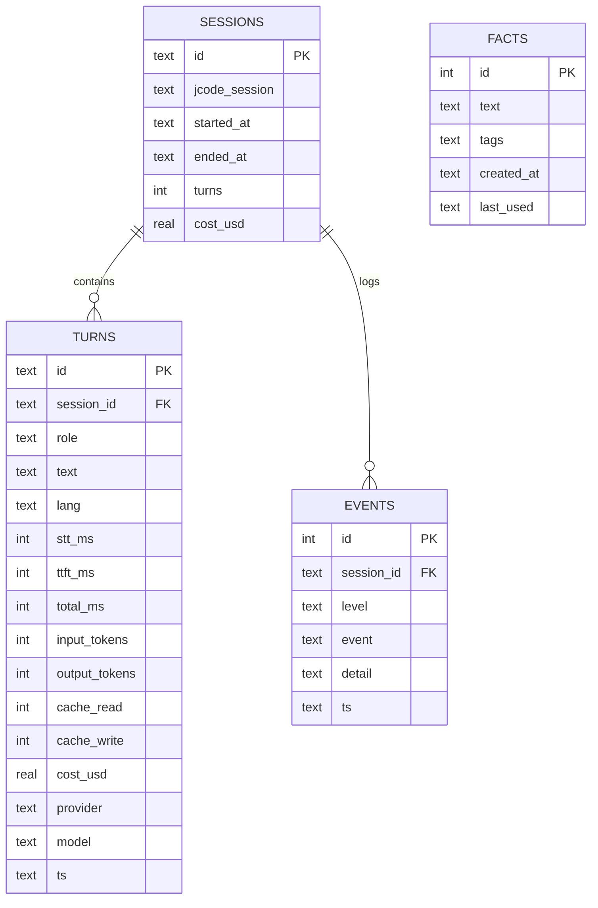

# Plan: `aium:jcode-jarvis` v2 control panel

Status: built, verification pending (runtime untested here)
Updated: 2026-10-31 20:15

## Goal

Turn the single-orb page into a desktop-first control panel: every local
subsystem visible at a glance, dense but grouped, with controls next to the
evidence they change. Voice stays the primary input; the panel becomes the
primary screen.

## What changes

- Voice-first page becomes an Operate-mode dashboard.
- Information already in SQLite (transcript, timings, cost, memory, events)
  becomes visible. No new model calls, no new data collection.
- Three new read endpoints, one settings endpoint, one export endpoint, and
  two fact endpoints. Everything else reuses the existing API.

## Layout (desktop first)

```
+------------------------------------------------------------------+
| Jarvis   [state] [Start/Stop]  provider/model  $today  dots  lang |
+---------------------------------------------+--------------------+
| Now                                          | Live               |
|  level ring + state + stage timer            |  event feed        |
|  transcript (scroll, newest last)            |  health per        |
|  last turn: STT / TTFT / TTS / total, tokens |  subsystem         |
|  text input                                  |  (whisper, piper,  |
+---------------------------------------------+  jcode, db, brain) |
| [Brain][Voice][Memory][Cost][System][Logs]   |                    |
|  active tab content, one row of controls      |                    |
+---------------------------------------------+--------------------+
```

- 1440x900 and 1280x800 are the target sizes. Below 900px the right rail
  collapses under Now; tabs become horizontal scroll. Below 600px it is one
  column in the current mobile rhythm.
- Existing tokens, one sans family, teal accent, light and dark kept. No new
  visual world; this is an expansion of the incumbent interface.
- No modal unless a destructive action needs confirmation.

## Panel contents

- **Top bar**: state, Start/Stop, provider/model, today spend, four health
  dots, language. Health dot click opens System.
- **Now**: level ring from the mic frames already computed, state, stage timer,
  scrollable transcript (last 50 turns), last-turn breakdown, text input,
  Cancel while a turn runs.
- **Live**: `/api/events` feed, newest first, level-colored text not color-only,
  health rows with the reason when down.
- **Brain**: provider, model, fallback chain, timeout, max output, Test, Apply.
- **Voice**: input language, voice per language, whisper profile/model, TTS
  on/off, mic device + live level, plus a diagnostics line with origin,
  `isSecureContext`, and mic permission state (settles the Firefox issue).
- **Memory**: fact list with per-fact forget, add fact, export JSON, forget all.
- **Cost**: last turn, session, today, 7-day sparkline, per-turn table (last 20).
- **System**: versions, profile, uptime, db size, image arch, export all data.
- **Logs**: filter by level, copy, limit.

## API contract (frozen for this plan)

New:

- `GET /api/history?limit=50` -> `{"turns":[{"role","text","lang","stt_ms",
  "ttft_ms","total_ms","input_tokens","output_tokens","cost_usd","provider",
  "model","ts"}]}` newest last, current session by default; `?all=1` spans
  sessions.
- `GET /api/cost?days=7` -> `{"days":[{"date":"YYYY-MM-DD","cost_usd":0.0,
  "turns":0}],"today":0.0,"session":0.0,"last":0.0}`.
- `GET /api/settings` -> `{"tts":true,"lang":"auto","voice_en":"...","voice_fr":
  "...","whisper_model":"...","profile":"standard"}`.
- `POST /api/settings` -> partial update of `tts`, `lang`, `voice_en`,
  `voice_fr`; persists to `/data/settings.json`; returns the new object.
- `GET /api/export?what=all|facts|turns` -> JSON download, no secrets.

Unchanged: `/api/status`, `/api/health`, `/api/brain`, `/api/brain/test`,
`/api/events`, `/api/facts`, `/api/forget`, `/api/usage`, `/api/session`,
`/api/chat`, `/api/turn`, `/api/tts`, `/api/cancel`.

## Phases and tasks

### Phase 0: close v1 (serial, coordinator)

1. Commit the current untracked work in logical slices. Files: `PLAN.md`,
   `PRODUCT.md`, `MEMORY.md`, `aium/jcode-jarvis/*`. Acceptance: `git status`
   clean apart from ignored files. **Done:** commit `7748193`; v2 follows in a
   second commit.
2. Rebuild the image and confirm `whisper-server` stays up (static build fix).
   Acceptance: no `exited 127` in the event feed, `/api/health` whisper true.
   **Pending:** needs podman, absent here.
3. Confirm the Firefox mic cause using the diagnostics contract above once the
   Voice tab exists; do not guess before then. **Tool shipped:** the Voice tab
   shows origin, secure context, permission state, and last mic error.

### Phase 1: backend (lane A, `jarvis.py`, `tests/test_jarvis.py`) **built**

1. `Store.history(limit, all_sessions)`, `Store.cost_by_day(days)`,
   `Store.per_turn_costs(limit)`. Acceptance: unit tests on a temp DB.
2. `Settings` load/save/merge with defaults in `/data/settings.json`; wire
   `tts`, `lang`, and voice selection into `Speech`/`Core.turn`.
   Acceptance: defaults on missing file, partial update, bad file tolerated.
3. Endpoints above with auth respected, JSON errors, no new dependency.
   Acceptance: unit tests for each handler function or a local HTTP smoke when
   Python is available.
4. Add `spend_today`, `uptime_s`, `version`, `arch` to `/api/status`.
   Acceptance: existing tests still pass.
5. Run: `python3 -m unittest discover -s tests` and
   `python3 jarvis.py --selftest`.

### Phase 2: panel shell (lane B, `index.html`)

**Built.** `DESIGN.md` added; detector reports no findings.

Depends only on the frozen contract, so it can run in parallel with phase 1.

1. `DESIGN.md` recording the existing tokens, type scale, and component
   vocabulary (buttons, chips, rows, pills, tabs, inputs). Acceptance: matches
   the shipped CSS; no invented values.
2. Grid shell, top bar, right rail, tab strip, responsive rules at 1440, 1280,
   900, 600, 440. Acceptance: no horizontal scroll at any width; keyboard tab
   order is top bar -> Now -> Live -> active tab.
3. Now panel: level ring from existing frames, transcript, turn breakdown,
   text input, Cancel. Acceptance: a turn renders transcript + timings without
   reload; transcript scrolls and keeps the newest visible.
4. Live panel: events + health. Acceptance: a supervisor event appears within
   one poll; health failure names the subsystem and the reason.
5. Tabs: Brain, Voice, Memory, Cost, System, Logs, one at a time, state kept
   when switching. Acceptance: every existing drawer control still works.
6. Voice diagnostics line: origin, secure context, permission state, last mic
   error. Acceptance: shows the Firefox error verbatim next to the fix hint.

### Phase 3: integration and verification (coordinator, serial)

**Integration done.** Old drawer removed, every control moved into a tab.

**Unverified here:** tests, selftest, HTTP smoke, screenshots, image rebuild.
See "Verification limits".

1. Wire the frontend to the real endpoints; delete the old drawer once no
   control is lost. Acceptance: feature checklist, no dead control.
2. Accessibility: labels, focus, AA contrast both themes,
   `prefers-reduced-motion`. Acceptance: keyboard-only pass; axe/DevTools clean.
3. Mechanical detector: `/root/.jcode/skills/impeccable/scripts/impeccable
   detect --json aium/jcode-jarvis/index.html`.
4. Screenshots at 1440x900, 1280x800, 440x900 in light and dark.
5. Full gate: unit tests, selftest, local HTTP smoke, image rebuild.

## Verification limits

This session's environment has no `python3`, no `podman`, and no browser
bridge. Phase 0.2, phase 1.5, phase 3.3-3.5 must run where those exist, or the
user runs them and pastes the output. Do not claim them as verified.

## Out of scope

- Wake word, always-on listening, multi-user, mobile app, timers.
- New brain providers, vector memory, cloud speech.
- Rewriting the UI framework or splitting `index.html` into a build step.
- Budget/spend cap (open decision; only add if asked).

## Risks

| Risk | Impact | Mitigation |
|---|---|---|
| `index.html` grows past ~2500 lines and becomes unmaintainable | Med | Keep sections as clearly marked blocks; no build step in v2 |
| Transcript leaks private text to a shoulder-surfer | Med | Local-only page, no share/export of transcript by default |
| Settings persistence changes voice while a turn runs | Low | Apply at next turn; show "applies next turn" |
| Health dots flicker into "down" during model load | Low | Grace period of 20 s after start, same as supervisor guard |
| Firefox mic issue is browser policy, not fixable in code | Med | Diagnostics line makes the cause explicit |

## Open questions

- Budget limit in or out of v2?
- Per-fact edit, or forget + export only?
- Keep the old drawer as a fallback path, or remove it at integration?

---

# Archive: v1 plan (implemented, verification pending)

# Plan: `aium:jcode-jarvis` voice companion image

Status: design review (awaiting approval)
Updated: 2026-10-31 11:32

## Goal

One Podman image that runs a bilingual (FR/EN) voice companion on amd64 and
arm64: local speech, local memory, local routing, and a cloud brain (DeepSeek
by default). Audio never leaves the machine.

## Priority order

1. Personal-data safety, with everything except the LLM kept local.
2. Low turn latency.
3. Lowest runtime resource use.
4. Image size, capped at 5 GB.

The LLM is the only cloud dependency. Speech, VAD, memory, routing, UI, and
session state stay local. When the cloud is down, local intents and memory
still work and the UI says so.

## Locked design decisions

- **One core, three frontends.** The voice core reads and writes 16 kHz mono
  PCM. Device audio (`arecord`/`aplay`), browser audio, and a headless HTTP
  endpoint are adapters over the same core.
- **Cloud brain, local everything else.** STT, TTS, VAD, intent routing,
  memory, and the UI run in the container. Only text and selected facts go to
  the configured provider. Audio never leaves.
- **Modular brain.** The provider/model pair is configuration, not code. The
  core uses jcode's provider registry, auth, model catalog, and provider
  profiles, with an env/UI override and a fallback chain.
- **Bilingual.** Whisper `base` multilingual with language auto-detect; Piper
  has one English and one French voice.
- **One container, one volume, one supervisor.** Python starts and watches
  `whisper-server`, `piper.http_server`, and serves the UI/API.
- **Light by default.** One image around 1 GB, no local model weights, speech
  profiles for Pi and desktop. Image size is capped at 5 GB and is not a
  constraint.

## Architecture schema

```mermaid
flowchart TB
  subgraph Clients
    D[Device<br/>mic + speaker<br/>arecord / aplay]
    B[Browser<br/>PCM in / WAV out]
    H[Headless HTTP<br/>scripts / Home Assistant]
  end

  subgraph Container["jcode-jarvis container (amd64 / arm64)"]
    A[Audio adapters<br/>device | browser | http]
    S[Core<br/>supervisor, state machine, router, cost]
    W[whisper-server<br/>local STT]
    P[piper http server<br/>local TTS]
    J[jcode child per turn<br/>--ndjson, tools off]
    DB[(SQLite /data/jarvis.db<br/>turns, facts, sessions, events)]
    CFG[config.toml<br/>pricing.json<br/>persona AGENTS.md]
  end

  subgraph Cloud
    C[Configured provider<br/>DeepSeek by default]
  end

  D --> A
  B --> A
  H --> A
  A --> S
  S --> W
  S --> P
  S --> J
  J --> C
  S --> DB
  S --> CFG
  S -->|audio out| A
  S -->|cost and status| A
```

| Component | Runs | Local | Responsibility |
|---|---|---|---|
| Audio adapters | core | yes | PCM capture, VAD endpointing, playback |
| Core | core | yes | state machine, routing, memory, cost, supervisor |
| whisper-server | child | yes | STT, language detection |
| piper http server | child | yes | TTS, per-language voice |
| jcode child | child per turn | no | cloud reasoning, streaming text |
| SQLite | volume | yes | transcript, facts, sessions, metrics, cost |
| pricing.json | volume or image | yes | per-model token rates for cost estimates |

## Data schema



- `facts` has an FTS5 index for recall.
- `turns.cost_usd` stores the exact or estimated cost for that turn.
- `sessions.cost_usd` is the running total.
- `events` keeps the last 200 events for the activity drawer; audio and
  transcript text are never written to stdout logs by default.

## Turn pipeline

1. VAD endpoints the utterance (about 800 ms of silence).
2. `whisper-server` returns text and detected language.
3. Router, in order:
   - local intent: stop, time/date, remember, forget, recall, goodbye;
   - local memory answer: SQLite FTS5 lookup;
   - otherwise `jcode run --ndjson --disable-base-tools` against the
     configured cloud provider.
4. `text_delta` events go through a sentence splitter into Piper; playback
   starts on the first sentence.
5. New speech during playback stops audio and cancels the active LLM
   request.
6. Turn metadata, facts, and cost are written to SQLite.

## Memory

One SQLite file, no vector database. Tables are in the data schema above.
- Explicit "remember that ..." writes a fact. Top facts plus the last few
  turns are injected into the active LLM prompt.
- Keep the last N turns in SQLite and summarize older turns. No unbounded
  jcode session.

## Cloud brain and prompt budget

The LLM is the only cloud dependency. `jcode run --ndjson --disable-base-tools`
against DeepSeek by default. No local model.

Measured on this host with tools disabled: `jcode run --ndjson` streams its
first text at about 1.7 s, with 6,406 input tokens and 6,144 cache reads. Process
startup is about 70 ms. That fits the voice budget below. Keep the conversation
compact:

- persona in a minimal `AGENTS.md`; replace the base image's coding-agent
  policy with the companion persona so it does not leak into voice replies;
- top facts plus the last 4 turns;
- rotate after 12 turns and summarize older turns in SQLite;
- cap spoken replies to 2-3 sentences.

If first-token latency is too high, test a direct DeepSeek chat call with a
500-1500 token prompt and compare. jcode stays the default because it keeps
memory, sessions, and future tools.

Latency budget on the Ryzen host, from speech end to first audio:

| Stage | Target |
|---|---|
| VAD endpoint | 0.6-0.8 s |
| whisper base | 0.5-1.2 s |
| DeepSeek first token | 0.8-1.8 s |
| first Piper sentence | 0.2-0.4 s |
| total | 2.1-4.2 s |

Pi 5 adds roughly 1-2 s of STT. Pi 4 uses `tiny` and accepts longer STT.

## Modular brain

The brain is a provider/model pair, not a hardcoded DeepSeek call. It uses
jcode's provider registry, auth store, model catalog, and provider profiles.

`/data/brain.toml`:

```toml
[brain]
backend = "jcode"          # jcode | mock
provider = "deepseek"
model = "deepseek-v4-flash"
fallback = ["openrouter:...", "ollama:..."]
timeout_ms = 15000
max_output_tokens = 120
temperature = 0.7
```

Precedence: CLI or env (`JARVIS_BRAIN_PROVIDER`, `JARVIS_BRAIN_MODEL`) over
volume `brain.toml` over image default. The core passes `--provider`,
`--model`, and `--provider-profile` to `jcode run`.

- **Discovery:** `jcode provider list` and `jcode model list -p <provider>`.
- **Profiles:** `jcode provider add` for OpenAI-compatible endpoints such as
  Ollama, LM Studio, or a custom gateway.
- **UI:** the details drawer has a Brain section with provider, model, Apply,
  and Test. The footer always shows the active model. Switching keeps the
  SQLite conversation.
- **Fallback:** on timeout or provider error, try the next entry in `fallback`.
  The UI shows which provider answered and marks fallback turns.
- **Capability filter:** offer only streaming chat models with at least 8k
  context, because the jcode prompt is about 6.4k tokens with tools off.
- **Privacy:** label each provider local or cloud. Switching to a cloud
  provider shows where text goes. Local providers keep everything on the
  machine.
- **Cost:** `pricing.json` is keyed by `provider/model`; unknown models show
  tokens only.
- **Secrets:** prefer environment variables or Podman secrets. The jcode auth
  store is optional and lives on the `0700` volume.

## Speech profiles and resource budget

No local model weights. One image around 1 GB.

| Profile | Whisper | Voices | RAM | Target |
|---|---|---|---|---|
| `low` | tiny q5 (~31 MB) | low (~20 MB each) | ~0.5 GB | Pi 4 |
| `standard` | base q5 (~57 MB) | medium (~63 MB each) | ~0.8-1.0 GB | default, Pi 5 |

Only one whisper model and one voice per language are loaded. The jcode child
exits after each turn. `JARVIS_PROFILE=low|standard`.

## Image contents

- Debian slim, Python 3 stdlib, `alsa-utils`, `ca-certificates`, `curl`, `git`.
- jcode from the official installer (supports linux-aarch64).
- whisper.cpp built in a builder stage: `whisper-server` + `whisper-cli`.
- Whisper `base` multilingual q5_1 (~57 MB) + Silero VAD (~1 MB).
- Piper venv (~34 MB) + `en_US-lessac-medium` and `fr_FR-siwis-medium` voices
  (~63 MB each). A `low` voice build arg cuts this for Pi.
- App: `jarvis.py`, `index.html`, persona `AGENTS.md`.
- `NOTICE` with Piper, espeak-ng, whisper.cpp, and jcode licenses.
- No ffmpeg: browser sends raw PCM; server wraps WAV with the standard library.

## Frontend UI

One static page, no framework, no CDN, no external fonts. Inline CSS and JS,
system font stack, inline SVG icons, under 15 KB. Works from 320 px to desktop,
touch and keyboard, light and dark via `prefers-color-scheme`.

Layout, top to bottom, centered column max 440 px:

1. Small wordmark, language chip (`Auto` / `EN` / `FR`), and a one-line
   privacy note on first run: "Audio stays on this device. Cloud gets text only."
2. One primary orb button, 112 px desktop and 96 px mobile. It is the only
   control that matters: tap or `Space` starts the session, tap again ends it.
3. One status line: Ready, Listening, Thinking, Speaking, Cloud unavailable,
   Microphone blocked.
4. Last exchange: user line dimmed, Jarvis reply clamped to three lines. A
   small "Log" control opens a plain-text drawer with the last 20 turns.
5. Secondary row, only when relevant: `Stop speaking`, `Mute`, `End session`.

States and feedback:

| State | Orb | Status | Action |
|---|---|---|---|
| Idle | neutral ring, mic icon | Ready | start session |
| Listening | ring pulses with mic level | Listening | tap to end |
| Thinking | slow arc, no spinner | Thinking | tap to cancel |
| Speaking | speaker icon, subtle pulse | Speaking | tap to stop speech |
| Error | amber ring | plain-language message | retry |
| Cloud down | neutral ring, quiet banner | Local mode | retry cloud |

Ergonomics:

- 44 px minimum touch targets; primary orb sits in the lower third on phones
  with safe-area padding.
- `Space` toggles the session, `Esc` stops speech, `L` toggles the log. No
  hover-only controls.
- `aria-live="polite"` on status and transcript; visible focus ring; state is
  conveyed by icon and text, not color alone.
- Mic permission is requested only after the first press, with a one-line
  explanation and a recovery message if denied.
- Motion is 150-250 ms `ease-out`, transform and opacity only, and disabled
  under `prefers-reduced-motion`. Pressed orb uses `scale(0.97)`.
- No animation on keyboard-initiated toggles. No layout shift between states.
- Language chip cycles Auto, EN, FR. No settings panel in v1.

### Info and telemetry

The default view stays one orb. Jcode-style detail lives in two layers:

1. **Slim footer**, always visible: `deepseek-v4-flash · 2.1s · 6.4k in · $0.0006 · 12 facts`.
   On narrow screens it collapses to the model and latency. Tapping it, or
   pressing `I`, opens the details drawer.
2. **Details drawer**, collapsed by default, remembered in `localStorage`.
   Desktop: side panel. Mobile: bottom sheet. Plain text, tabular numbers,
   monospace for values.

Drawer sections:

| Section | Fields |
|---|---|
| Session | state, short session id, turns, started, language |
| Model | provider, model, switch, test, local or cloud |
| Last turn | STT ms, first-token ms, total ms, input/output tokens, cache read/write |
| Cost | this turn, session total, today/month/all-time, balance, pricing source |
| Speech | whisper model, detected language, Piper voice, audio device |
| Memory | fact count, last recalled facts, database size |
| Health | whisper-server, Piper, jcode, cloud reachability |
| Activity | last 20 events with timestamps, copy button |

The activity line under the orb mirrors jcode's status updates while a turn
runs: `Transcribing 0.8s`, `Thinking`, `Speaking`, with the current stage and
elapsed time. Tool activity appears only if tools are enabled later.

Data sources: `--ndjson` events (`start`, `text_delta`, `message_end`,
`tokens`, `done`), stage timestamps from the core, and `/api/status`. No
transcript text is written to logs by default; the drawer can show the local
turn history.

### Cost

- **Per turn**: read the exact cost from jcode's local usage store when it has
  one. Otherwise estimate from `pricing.json` with per-million input, output,
  cache-read and cache-write rates for the active provider and model. The
  footer labels an estimate with `~`.
- **Session**: sum `turns.cost_usd` for the active session.
- **Machine**: today, this month, and all-time local spend from
  `jcode usage --json` (`Local spend`), plus provider balance when available.
  Refreshed at most every five minutes, hidden when the network is down.
- **Local speech**: `$0.00` with a `local compute` label. The only spend is
  the cloud brain.
- The footer uses local state only and never makes a network call. Pricing is
  editable in `pricing.json`; unknown models show tokens without a dollar
  figure.

## Security and privacy

- All audio and speech processing is local. Only text, persona, and selected
  facts go to the configured cloud provider, and the UI shows a cloud
  indicator.
- Cloud outage: local intents, memory, time/date, and the UI still work. An
  open-ended turn returns a clear "cloud unavailable" message instead of
  failing silently.
- Telemetry and auto-update are disabled (`JCODE_NO_TELEMETRY=1`,
  `DO_NOT_TRACK=1`, `jcode telemetry none`, `--no-update`). No third-party
  scripts, fonts, or assets.
- Bind `127.0.0.1` by default. LAN or phone access needs a bearer token,
  Origin/CSRF checks, and HTTPS for browser microphones.
- jcode runs with tools disabled, so voice input cannot execute commands.
- The data volume is `0700`. Use host disk encryption for data at rest. Provide
  `jarvis export` and `jarvis forget` for all personal data.
- Transcripts and audio are never written to stdout logs. Events are retained
  with a cap and can be wiped.
- Browser mode needs `localhost` or HTTPS. Device mode needs a Linux host with
  `/dev/snd`; Windows Podman uses browser mode.
- Pi 4: `tiny` whisper and `low` voices. The cloud brain adds network latency,
  not model RAM.

## Risks and open questions

Must resolve before coding:

1. **Latency SLO.** No measurable target yet. Proposal: end of speech to first
   audio under 3.5 s on the Ryzen host and under 6 s on Pi 5; local intents
   under 1.5 s. Add a latency waterfall and a test.
2. **Echo cancellation.** Jarvis will hear its own TTS without AEC or a
   half-duplex guard. Browser needs `echoCancellation`, `noiseSuppression`,
   `autoGainControl`; device mode needs a mic mute while speaking or real AEC.
3. **State machine contract.** The pipeline is a list, not a table. Define
   transitions and actions for: enable, speech, endpoint, partial, first token,
   sentence, playback end, barge-in, cancel, timeout, error, stop, and
   single-session lock.
4. **Device-mode session toggle.** Browser has the orb; device mode has no
   control. Add `jarvis listen`, a local API, or a GPIO button.
5. **Memory contract.** FTS5 is weak for French. Define scoring, top-k, token
   budget, recency, conflict resolution, forget, and retention. Define session
   rotation threshold and summary behavior.
6. **Cloud and offline policy.** Cloud is the only external dependency. Define
   behavior when cloud, whisper, Piper, or mic fails. Add a circuit breaker with
   backoff and a clear mode indicator. Local intents and memory stay available.
7. **Cost accuracy.** Depending on jcode's usage store is an internal
   dependency. Confirm its schema or keep the pricing estimate fallback. Test
   the math with a known turn.
8. **Licensing.** Piper1 is GPL-3.0 and embeds espeak-ng (GPL-3.0); voices
   carry their own licenses; Whisper is MIT. Add a `NOTICE` and source offer if
   the image is distributed.
9. **Build pinning.** jcode's installer defaults to latest. Pin
   `JCODE_VERSION`, whisper.cpp commit, Piper wheel, and model checksums.
10. **Supervisor policy.** Restart and backoff for whisper, Piper, and jcode;
    per-stage timeouts; orphan cleanup; health semantics.
11. **Security.** LAN token plus Origin/CSRF checks, TLS for browser mic,
    volume permissions, retention and export, prompt-injection review.
12. **Pi limits.** Memory and thread caps, `tiny` and `low` profiles. The cloud
    brain adds network latency but no model RAM.

13. **Privacy proof.** Add a data audit that lists every field that can leave
    the machine, and a test that local intents, memory, and speech work with
    `--network none`; an open-ended turn fails with a clear message.
14. **Prompt size.** Cloud mode should stay near 6.4k tokens with tools off.
    Add a test that fails if the prompt grows without intent, because it raises
    both cost and first-token latency.
15. **Brain configuration.** Define schema, precedence, validation, fallback,
    secrets, and behavior when a provider or model disappears. Test switching
    mid-session.
16. **Provider matrix.** For each allowed provider record local or cloud,
    streaming, context window, cost, retention policy, and persona support.
    Filter the UI list to supported models.
17. **Prompt portability.** The persona and output format must work across
    providers. Add a small eval set per provider and a max-output rule.
18. **Fallback policy.** Define timeout, retry count, which errors trigger
    fallback, and how the UI shows that a fallback answered.
19. **Model switching UX.** Apply and Test need clear feedback, and a failed
    switch must keep the previous working brain.

Missing artifacts: SLO and acceptance doc, state machine table, threat model,
hardware support matrix, `NOTICE`, latency waterfall, data retention and
export, cost test fixture, pinned build inputs, real-hardware test plan,
brain config schema, provider capability and privacy matrix.

## Steps

| # | Step | Files | Status |
|---|---|---|---|
| 1 | Core: state machine, router, memory, adapters, supervisor, `--selftest` | `aium/jcode-jarvis/jarvis.py` | done |
| 2 | Browser page: session toggle, PCM capture, VAD, playback | `aium/jcode-jarvis/index.html` | done |
| 3 | Persona and config | `aium/jcode-jarvis/AGENTS.md`, `config.toml`, `brain.toml`, `pricing.json` | done |
| 4 | Multi-arch Dockerfile, speech model downloads, cloud provider config | `aium/jcode-jarvis/Dockerfile` | done |
| 5 | README: run commands for device, browser, Pi, cloud setup | `aium/jcode-jarvis/README.md`, `NOTICE` | done |
| 6 | Wire build/push/run and CI | `run.ps1`, `.github/workflows/deployment_ci.yml` | out of scope, user limited work to this dir |
| 7 | Verify | tests, local smoke, image build | in progress |

## Verification

- `python3 jarvis.py --selftest` passes all checks.
- `python3 -m unittest discover -s tests` passes 8 tests.
- Live SSE turn against DeepSeek: transcript, sentence, and done events;
  first token about 1.4-1.5 s, total about 1.6-1.8 s.
- Local API smoke: page 200, health 503 when speech services are absent,
  status, memory remember/recall, brain switch, and usage.
- Headless Firefox screenshot confirms the orb layout at 440x900.
- Image build is running under Podman vfs storage. Microphone and Piper audio
  still need a real device test.

## Out of scope

- Wake word, always-on listening, cloud speech, vector database, multi-user,
  mobile app, timer parsing.
- Changes to existing images.
